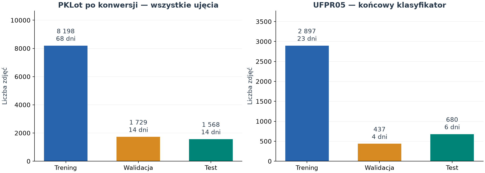
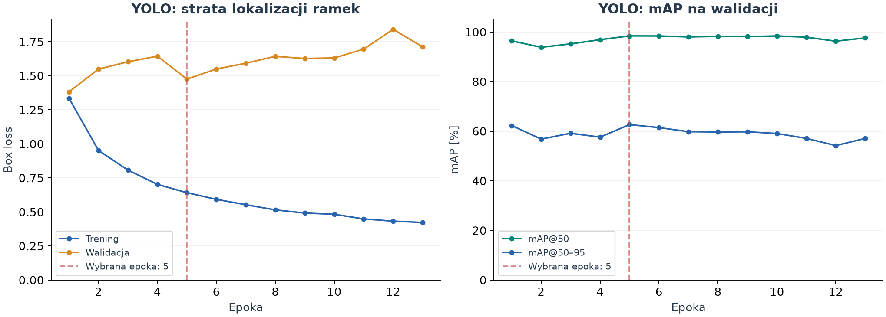
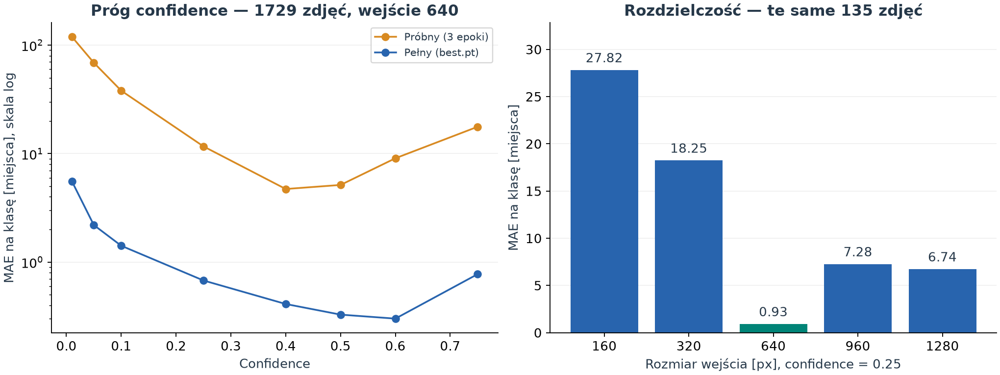
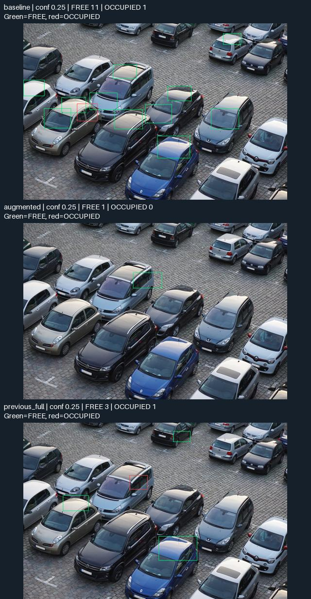
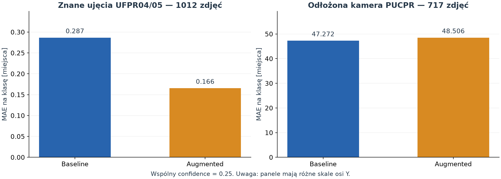
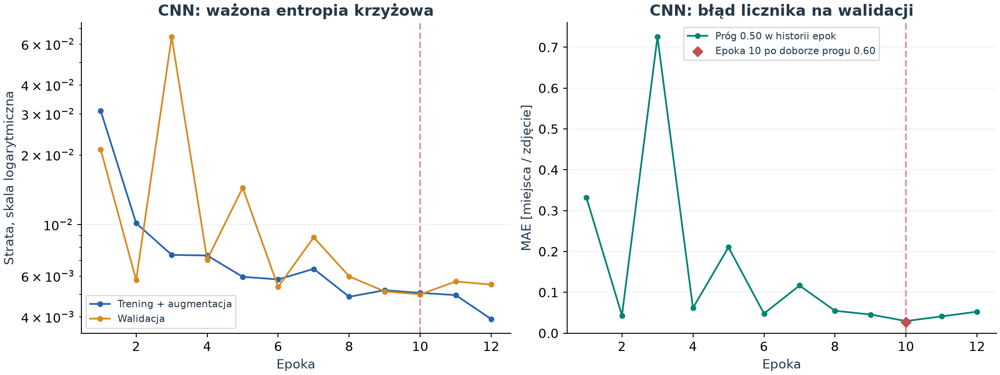
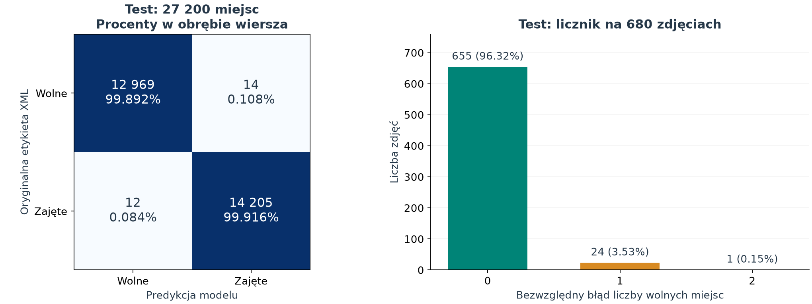
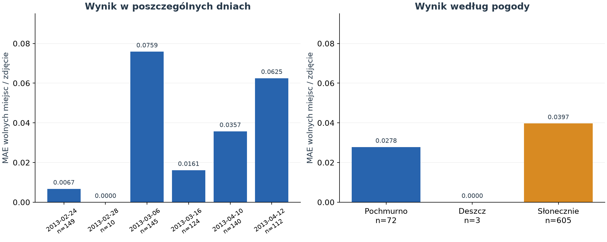
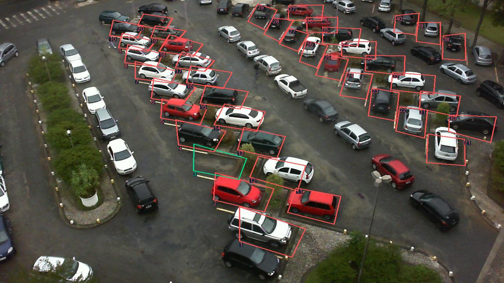

# Smart Parking Vision — realizacja projektu i wyniki eksperymentów

**Big Data w Przemyśle 4.0 · Politechnika Wrocławska · eksperymenty z 24–26.10.2026**

W projekcie przygotowano dane PKLot, wytrenowano modele rozpoznające wolne i zajęte miejsca parkingowe oraz zbudowano lokalną aplikację do analizy zdjęć. Prace rozpoczęły się od detektora YOLO, który miał jednocześnie odnajdywać miejsca i rozpoznawać ich zajętość. Po zbadaniu jego ograniczeń przygotowano drugi wariant: mały klasyfikator CNN działający na wcześniej wskazanych miejscach w obrazie ze stałej kamery.

**Końcowy rezultat:** aplikacja dla ujęcia UFPR05, 40 skonfigurowanych miejsc, **99,904% zgodności klasyfikacji z XML** i **dokładny licznik na 655 z 680 zdjęć testowych**. Jest to wynik dla znanej kamery na odłożonych dniach. Automatyczna lokalizacja miejsc na dowolnym parkingu pozostała niezrealizowanym założeniem pierwotnej wersji.

## 1. Dane i przygotowanie zbioru

Wykorzystano lokalny zbiór **PKLot**: pełne zdjęcia parkingów oraz pliki XML zawierające identyfikatory, wielokąty miejsc i oznaczenia zajętości. Analizowane ujęcia to PUCPR, UFPR04 i UFPR05, w warunkach słonecznych, pochmurnych i deszczowych. UFPR04 i UFPR05 przedstawiają ten sam parking z różnych punktów widzenia.

Najpierw sprawdzono poprawność obrazów, kompletność XML, statusy miejsc, geometrię i daty. Z 12 417 zdjęć do konwersji zakwalifikowano **11 495 zdjęć i 653 276 oznaczeń miejsc**. Wykluczono 922 zdjęcia ze względu na brakujące statusy, brak XML lub niejednoznaczne daty; powody mogą się nakładać. Dla 52 zaakceptowanych zdjęć datę odzyskano z nazwy pliku zamiast błędnej nazwy katalogu. Oryginały pozostawiono bez zmian.

Dla YOLO wielokąty zamieniono na prostokąty równoległe do osi obrazu, zapisane jako `class x_center y_center width height` ze współrzędnymi w zakresie 0–1. Klasy: **0 = FREE**, **1 = OCCUPIED**. Zdjęcia kopiowano bez skalowania i rekompresji.

Podział wykonano **według dat**, z `seed=42`. Cały dzień trafiał do jednej części, również gdy występował w kilku ujęciach lub grupach pogodowych. Ogranicza to mieszanie bardzo podobnych zdjęć między treningiem i oceną, ale nie zamienia podziału na test nowej kamery.

| Część zbioru | Zdjęcia | Daty | Miejsca FREE | Miejsca OCCUPIED |
|---|---:|---:|---:|---:|
| Trening | 8 198 | 68 | 263 340 | 208 616 |
| Walidacja | 1 729 | 14 | 41 857 | 63 423 |
| Test | 1 568 | 14 | 37 919 | 38 121 |



**Omówienie wykresu.** Wersja końcowa wykorzystuje podzbiór istniejącego podziału — wyłącznie UFPR05. Nie losowano ponownie pojedynczych miejsc. Proporcje zdjęć różnią się od założonych proporcji dni, ponieważ poszczególne dni zawierają różne liczby zdjęć. Końcowo oceniono 680 zdjęć testowych UFPR05; pozostałe 888 zdjęć pierwotnego testu nie było częścią tej oceny.

Szczegóły przygotowania danych: [audyt PKLot](docs/audyt_pklot.md) i [konwersja do YOLO](docs/konwersja_yolo.md).

## 2. Technologie i środowisko

| Technologia | Rola w projekcie |
|---|---|
| Python 3.11.17, `uv` | Skrypty przygotowania danych, treningu i oceny; zarządzanie środowiskiem i zależnościami |
| PyTorch 2.14.1+cu130, CUDA 13.0 | Obliczenia na GPU, trening własnego CNN, inferencja na CPU |
| Ultralytics 8.4.187, YOLO26n | Dostrajanie detektora dwóch klas, walidacja detekcji i predykcje |
| NumPy, OpenCV, Pillow | Tablice danych, maskowanie wielokątów, skalowanie wycinków, odczyt i wizualizacja obrazów |
| Matplotlib | Wykresy na podstawie zapisanych historii treningu i wyników oceny |
| XML, CSV, JSON, YAML | Adnotacje źródłowe, manifesty podziału, konfiguracje i wyniki |
| HTML, CSS, JavaScript + lokalny serwer HTTP w Pythonie | Interfejs aplikacji, edycja obrysów, wysyłanie zdjęcia do lokalnej analizy |
| pytest, SHA-256 | Kontrole geometrii, podziału danych i metryk; identyfikacja plików eksperymentu |

Treningi wykonano lokalnie na **NVIDIA GeForce RTX 5070 Laptop GPU**, w środowisku Windows. Wersje bibliotek w tabeli odpowiadają zapisom eksperymentów. Przygotowano także [eksport do Kaggle](docs/kaggle.md), ale raportowane treningi wykonano na lokalnym komputerze — nie są to wyniki z Kaggle ani Colab.

## 3. Kolejne warianty treningu

| Etap | Dane treningowe | Wykonane epoki | Wybrany checkpoint | Czas i zakres pomiaru |
|---|---:|---:|---|---|
| YOLO — próba techniczna | 540 zdjęć | 3 | Najlepszy na walidacji próbnej | 90,4 s: wywołanie treningu z walidacją |
| YOLO — pełny trening | 8 198 zdjęć | 13 z limitu 30 | Epoka 5 | Około 2 h 7 min: całe uruchomienie |
| YOLO — baseline bez PUCPR | 5 314 zdjęć | 11 z limitu 30 | Epoka 3 | 15 min 42 s: trening |
| YOLO — mocniejsze augmentacje bez PUCPR | 5 314 zdjęć | 30 | Epoka 28 | 42 min 45 s: trening |
| CNN — stała kamera UFPR05 | 115 880 wycinków z 2 897 zdjęć | 12 | Epoka 10 | Około 114 s: przygotowanie danych, trening i podglądy |

Czasy opisują rzeczywiste uruchomienia o różnym zakresie, rozmiarze danych i obciążeniu komputera. Nie są kontrolowanym porównaniem szybkości architektur.

### Próba techniczna YOLO

YOLO26n dostrojono z ogólnych wag do klas FREE/OCCUPIED. Próbka obejmowała po 60 zdjęć treningowych i 15 walidacyjnych z każdej pary ujęcie–pogoda: razem 540/135 zdjęć. Parametry: 3 epoki, wejście 640 × 640, batch 8, AdamW, learning rate 0,001, `seed=42`, FP32 i wyłączony mosaic.

Na 135 zdjęciach próbnej walidacji uzyskano precision 0,8626, recall 0,8091, mAP@50 0,8860 i mAP@50–95 0,4604. Podglądy ujawniły jednak duplikaty i nadmiarowe ramki. Próba potwierdziła działanie całego procesu, lecz nie dawała jeszcze wiarygodnego licznika.

### Pełny trening YOLO

Następnie użyto wszystkich 8 198 zdjęć treningowych i 1 729 walidacyjnych. Zachowano wejście 640, batch 8, AdamW i początkowy learning rate 0,001. Włączono AMP, użyto 2 procesów ładowania danych, `scale=0.2`, wyłączono mosaic. Limit wynosił 30 epok, a early stopping zatrzymywał trening po 8 epokach bez poprawy. Najlepszy checkpoint pochodził z epoki 5; cały trening zakończył się po 13 epokach.



**Omówienie wykresu.** Strata lokalizacji na treningu maleje, ale strata walidacyjna nie podąża za nią. Po wybranej epoce mAP@50–95 nie poprawia się trwale. Dalsza redukcja straty treningowej nie przekłada się więc na dokładniejsze ramki w walidacji. To uzasadnia wybór wcześniejszego checkpointu i diagnostykę, zamiast automatycznego wydłużania treningu.

Końcowa walidacja najlepszego checkpointu na 1 729 zdjęciach dała:

| Metryka detekcji | Wynik |
|---|---:|
| Precision | 0,9766 |
| Recall | 0,9551 |
| mAP@50 | 0,9844 |
| mAP@50–95 | 0,6279 |

Wykres przedstawia historię zapisywaną w epokach, a tabela osobną walidację końcową najlepszego checkpointu; stąd niewielka różnica wartości. **mAP nie jest procentem poprawnie policzonych miejsc.** Wysokie mAP@50 przy niższym mAP@50–95 pokazuje również znaczenie dokładności dopasowania ramek.

## 4. Diagnostyka: progi, rozdzielczość i własne zdjęcia

Oba modele YOLO porównano na tej samej pełnej walidacji. Dodatkowo sprawdzono zmianę rozdzielczości na wspólnej próbce 135 zdjęć oraz wykonano predykcje dla dwóch własnych zdjęć spoza PKLot.

Do oceny licznika użyto **MAE na klasę**:

```text
MAE na klasę = suma(|FREE_pred − FREE_XML| + |OCCUPIED_pred − OCCUPIED_XML|) / (2 × liczba zdjęć)
```

Jednostką są miejsca na zdjęcie na klasę. Osobne wartości bezwzględne zapobiegają znoszeniu się błędów FREE i OCCUPIED.



**Omówienie wykresu.** Po lewej porównano modele przy wejściu 640 na 1 729 zdjęciach; oś błędu jest logarytmiczna. Bardzo niski próg dopuszcza wiele nadmiarowych wykryć. Dla pełnego modelu najlepszy badany próg 0,60 dał MAE na klasę około **0,30**, wobec około **4,72** dla modelu próbnego przy jego najlepszym badanym progu 0,40. To dobór na walidacji, nie niezależny test.

Prawy panel dotyczy wyłącznie pełnego modelu, tych samych 135 zdjęć i stałego progu 0,25. Najlepszy wynik uzyskano przy 640 px. Zwiększenie wejścia do 960 lub 1280 nie poprawiło jakości, a zmniejszenie do 160/320 wyraźnie ją pogorszyło. **Zmiana rozdzielczości bez sprawdzenia jakości nie jest prostą metodą ulepszenia ani przyspieszenia tego modelu.** Wartości z obu paneli pochodzą z różnych liczebności walidacji i nie należy porównywać ich bezpośrednio.

Na własnych zdjęciach wysoka jakość ze znanych ujęć nie została zachowana: model pomijał miejsca, a część ramek obejmowała dachy lub fragmenty samochodów. Obniżanie progu dodawało kolejne ramki, ale nie usuwało problemu. Dla tych zdjęć nie przygotowano etykiet referencyjnych, dlatego ich ocena pozostaje wizualna.



**Omówienie obrazu.** Plansza zestawia baseline, wariant z mocniejszą augmentacją oraz wcześniejszy pełny model, przy wejściu 640 i progu 0,25. Sama większa liczba ramek nie oznacza lepszego wyniku. Na tym zdjęciu widać także błędne przypisania FREE do obszarów zajętych przez samochody.

W diagnostyce znaleziono też podejrzane oznaczenia źródłowe. Porównanie z XML i sumami kontrolnymi potwierdziło, że wybrane rozbieżności nie powstały w konwerterze. Etykiet nie zmieniano i nie usuwano trudnych zdjęć z raportowanych wyników. Pełny opis: [diagnostyka modeli](docs/diagnostyka_modelu.md).

## 5. Czy mocniejsze augmentacje pomagają na nowej kamerze?

Przygotowano kontrolowany eksperyment: **trening wyłącznie na UFPR04/UFPR05**, a PUCPR odłożono jako nieznane ujęcie. Użyto 5 314 zdjęć treningowych i 1 012 walidacyjnych znanych kamer. Ocenę PUCPR wykonano po treningu na 717 zdjęciach z części rozwojowej danych. Nie był to pierwotny końcowy zbiór testowy.

Oba warianty startowały z ogólnych wag YOLO26n, z wejściem 640, batch 8, `seed=42`, limitem 30 epok i patience 8. Różnił je zestaw augmentacji:

| Ustawienie | Baseline | Augmented |
|---|---:|---:|
| Skala (`scale`) | 0,20 | 0,70 |
| Obrót (`degrees`) | 0° | 15° |
| Przesunięcie (`translate`) | 0,10 | 0,15 |
| Perspektywa (`perspective`) | 0 | 0,0005 |



**Omówienie wykresu.** Przy wspólnym confidence 0,25 augmentacje zmniejszyły MAE na znanych kamerach z **0,287 do 0,166**, ale na PUCPR błąd pozostał bardzo duży: **47,272 i 48,506** miejsca na klasę. Panele celowo mają różne, jawnie opisane skale osi Y. Na obrazach PUCPR opisano po 100 miejsc, natomiast modele zwracały średnio tylko około 5,47 i 3,00 ramki. mAP@50 było praktycznie zerowe.

Progi dobrane tylko na znanych kamerach również nie pomogły: baseline przy 0,50 osiągnął MAE PUCPR 49,122, a augmented przy 0,60 — 49,643. Większość stanowisk pozostała niewykryta.

Wynik pokazuje, że **sprawdzony zestaw augmentacji poprawił walidację w znanym środowisku, ale nie rozwiązał przenoszenia na inne ujęcie**. Nie dowodzi to nieskuteczności wszystkich augmentacji ani wszystkich detektorów. Zmieniono cztery parametry jednocześnie, użyto jednego seeda i jednej odłożonej kamery; faktyczna liczba epok była różna. Szczegóły: [wyniki eksperymentu z kamerą](docs/wyniki_eksperymentu_kamera.md).

## 6. Zmiana rozwiązania: stałe miejsca i mały CNN

Po eksperymentach zawężono zastosowanie do konkretnego parkingu obserwowanego ze stałej kamery. Lokalizacje miejsc zapisuje się w konfiguracji, a sieć odpowiada już tylko na pytanie o zajętość każdego z nich. W finalnym wariancie **nie działa YOLO** — jest to osobny klasyfikator, wytrenowany od zera.

```text
Zdjęcie + konfiguracja 40 wielokątów
    → wycięcie każdego miejsca i maskowanie tła
    → skalowanie do 64 × 64 RGB z zachowaniem proporcji
    → CNN: prawdopodobieństwo OCCUPIED
    → próg 0,60
    → FREE/OCCUPIED, liczniki i obraz z obrysami
```

Wybrano UFPR05. Geometrię pobrano z pierwszego zdjęcia treningowego i potwierdzono zgodność identyfikatorów oraz wielokątów w ocenianych zdjęciach. Piksele poza obrysem miejsca zastąpiono szarością RGB 127; taką samą wartość zastosowano do dopełnienia obrazu. Trening i aplikacja używają tej samej funkcji przygotowania wycinków. Piksele wejściowe normalizowane są do zakresu od −1 do 1.

### Architektura i trening

Sieć `OccupancyNet` składa się z trzech bloków Conv2D → BatchNorm → ReLU → MaxPool, z 16, 32 i 64 kanałami. Następnie wykorzystuje AdaptiveAvgPool do 4 × 4, warstwę 1024 → 64, ReLU, dropout 0,2 oraz warstwę wyjściową dla dwóch klas. Łącznie ma **89 426 parametrów**. Checkpoint zajmuje **365 473 bajty, około 0,35 MiB**.

| Ustawienie | Wartość |
|---|---|
| Dane treningowe | 2 897 zdjęć, 23 dni, 115 880 wycinków |
| Walidacja | 437 zdjęć, 4 inne dni, 17 480 wycinków |
| Wejście | RGB, 64 × 64 dla każdego miejsca |
| Inicjalizacja | Od zera, bez gotowych wag |
| Optymalizator | AdamW, learning rate 0,001, weight decay 0,0001 |
| Batch, seed | 256, seed 42 |
| Funkcja straty | Entropia krzyżowa z wagami klas odwrotnymi do ich częstości |
| Augmentacja | Losowe odbicie poziome, zmiany jasności i kontrastu |
| Obliczenia treningowe | CUDA, AMP |
| Limit / wykonanie | 12 epok / 12 epok, patience 4 |
| Wybór checkpointu | Minimalna ważona strata walidacyjna: epoka 10 |
| Próg końcowy | 0,60, dobrany na walidacji z siatki 0,10–0,90 co 0,05 |

Próg wybrano według balanced accuracy, przy remisie uwzględniając błąd licznika, a następnie odległość od 0,50. Testu nie używano do wyboru epoki ani progu.



**Omówienie wykresu.** Strata treningowa szybko maleje. Walidacja jest mniej stabilna — szczególnie w epoce 3 — a później oscyluje na niskim poziomie. Wybrano epokę 10, nie ostatnią. Krzywa MAE w historii jest liczona przy progu 0,50; osobny czerwony punkt przedstawia wybrany checkpoint po ustaleniu progu 0,60. Dzięki temu zmiany progu nie są przedstawione jako efekt samego treningu. Straty train/val nie muszą być identyczne, ponieważ trening obejmuje augmentację i dropout.

Walidacja wybranego modelu i progu dała **99,931% accuracy**, 12 rozbieżności na 17 480 miejsc oraz MAE licznika 0,0275. W przeglądzie tych 12 przypadków miejsca wyglądały na puste mimo etykiety OCCUPIED. Część zasłaniały fragmenty sąsiednich aut. Potraktowano to jako podejrzenie niespójności etykiet, bez korekt referencji i bez deklarowania „poprawionej” skuteczności. [Plansza wszystkich rozbieżności walidacyjnych](docs/report_assets/validation_disagreements.jpg).

## 7. Końcowa ocena na odłożonym teście UFPR05

Przed oceną zapisano kopię wag, geometrii i kodu oraz ich SHA-256. Użyto niezmienionego checkpointu z epoki 10 i progu 0,60. Test objął **wszystkie 680 zdjęć UFPR05 z 6 odłożonych dni**, po 40 miejsc na zdjęcie. Obrazy porównano z oryginałami, a geometrię i oznaczenia z XML. Nie poprawiano etykiet i nie dostrajano modelu na podstawie testu.

| Metryka | Wynik testowy |
|---|---:|
| Poprawne klasyfikacje | **27 174 / 27 200 — 99,904%** |
| Balanced accuracy | 99,904% |
| Macro-F1 | 0,999042 |
| Wolne błędnie uznane za zajęte | 14 / 12 983 |
| Zajęte błędnie uznane za wolne | 12 / 14 217 |
| MAE liczby wolnych miejsc na zdjęcie | **0,0382 miejsca** |
| Dokładny licznik | **655 / 680 — 96,324%** |
| Zdjęcia z błędem o 1 miejsce | 24 |
| Zdjęcia z błędem o 2 miejsca | 1 |
| Maksymalny błąd licznika | 2 miejsca |



**Omówienie wykresu.** Macierz pokazuje 26 rozbieżności względem oryginalnego XML. Procenty są liczone w obrębie klasy referencyjnej. Prawy panel pokazuje praktyczny efekt: na większości zdjęć licznik jest dokładny, ale nawet accuracy bliskie 100% nie oznacza bezbłędności całej klatki. W tym teście poprawny licznik pokrywał się z poprawną klasyfikacją wszystkich miejsc; ogólnie błędy przeciwnych klas mogą się wzajemnie znosić w liczniku.

Przy stałych 40 miejscach błąd liczby FREE i OCCUPIED ma tę samą wartość bezwzględną. Suma FREE + OCCUPIED zawsze wynosi 40, dlatego jej poprawność nie jest miarą skuteczności klasyfikatora. Nie należy również zestawiać accuracy CNN bezpośrednio z mAP detektora YOLO — inne są zadania, dane i warunki oceny.



**Omówienie wykresu.** Największy MAE spośród dni testowych wystąpił 6 marca: około 0,0759 miejsca na zdjęcie. Wyniki pogodowe wymagają ostrożności: test zawiera **605 zdjęć słonecznych, 72 pochmurne i tylko 3 deszczowe**. Brak błędów dla deszczu nie wystarcza do potwierdzenia odporności na takie warunki. Z kolei 24 lutego wszystkie miejsca w referencji były wolne, więc ten dzień nie sprawdza rozpoznawania zajętych stanowisk.

W testowych rozbieżnościach powtarzają się cienie i fragmenty sąsiednich aut. Część etykiet również wygląda niespójnie z obrazem. Są to obserwacje wizualne, bez niezależnego potwierdzenia przyczyny. [Plansza wszystkich 26 rozbieżności testowych](docs/report_assets/test_disagreements.jpg).

Ocena dotyczy znanej kamery i odłożonych dni, a nie nowej lokalizacji. Kolejne zdjęcia są powiązane czasowo, więc 27 200 wycinków nie oznacza tylu niezależnych scen. Test został już wykorzystany; dalsze strojenie na podstawie tych wyników wymaga nowego niezależnego zbioru do oceny końcowej.

## 8. Działająca aplikacja

Interfejs pozwala wczytać przykład UFPR05 lub własne zdjęcie, narysować wielokąty miejsc, zaimportować i wyeksportować konfigurację JSON oraz uruchomić analizę. Wynik zawiera liczby FREE/OCCUPIED, obrysy, identyfikatory miejsc i wartości prawdopodobieństwa. Można pobrać obraz wynikowy; aplikacja zapisuje też JSON z wynikiem i używaną konfigurację.



**Omówienie obrazu.** Przykład walidacyjny z deszczem: 1 wolne i 39 zajętych miejsc, zgodnie z referencją. Zieleń oznacza FREE, czerwień OCCUPIED. Przykład pochodzi z trzech demonstracyjnych zdjęć wybranych deterministycznie według pogody i nazwy pliku, bez selekcji według jakości modelu. Sam ten obraz nie zastępuje oceny testowej.

Konfiguracja przechowuje współrzędne znormalizowane. Możliwa jest zmiana rozdzielczości przy zachowaniu kadru i proporcji. Przesunięcie lub obrót kamery wymaga ponownej konfiguracji; aplikacja nie wykrywa automatycznie takiej zmiany. Możliwość narysowania miejsc na innym zdjęciu nie oznacza, że model UFPR05 będzie tam skuteczny.

## 9. Wydajność i założenie Raspberry Pi

Finalną inferencję zmierzono na CPU komputera, z 4 wątkami PyTorch, po rozgrzewce, w 30 pomiarach obejmujących po 40 miejsc:

| Pomiar końcowego CNN | Wynik |
|---|---:|
| Mediana czasu analizy | **19,36 ms** |
| 95. percentyl | 24,32 ms |
| Liczba parametrów | 89 426 |
| Rozmiar checkpointu | Około 0,35 MiB |

Zakres pomiaru: wcześniej wczytany obraz RGB → przygotowanie wycinków → CNN → liczniki i obraz z obrysami. Nie obejmuje odczytu pliku, ładowania modelu, kodowania JPEG ani interfejsu przeglądarkowego.

Mały model i działanie na CPU są argumentami za dalszym zbadaniem wdrożenia na słabszym urządzeniu. **Nie uruchamiano tego modelu na Raspberry Pi, nie wykonano eksportu ani kwantyzacji i nie zmierzono wydajności ARM.** Wyników desktopowego CPU nie przeliczano na RPi. Dla tej platformy należałoby zweryfikować obsługę modelu przez docelowy runtime, czas całego przetwarzania oraz jakość po ewentualnej optymalizacji. Trening może nadal odbywać się na GPU; na urządzeniu docelowym potrzebna byłaby tylko inferencja.

## 10. Wnioski z realizacji

1. **Pełny trening poprawił YOLO w znanym środowisku**, ale wysoki wynik walidacji nie przełożył się na własne zdjęcia i odłożoną kamerę. Podział według dat sprawdza inne dni, nie automatycznie nowe parkingi.
2. **Sam próg i większa rozdzielczość nie rozwiązały problemu.** Próg ograniczał nadmiarowe ramki, a wejście 640 najlepiej odpowiadało sprawdzonemu modelowi. Zmiany parametrów należało mierzyć, zamiast zakładać poprawę.
3. **Sprawdzona augmentacja nie zapewniła przenoszenia na PUCPR.** Lepsza walidacja znanych kamer współistniała z bardzo słabą oceną nieznanego ujęcia. Był to istotny wynik negatywny, który uzasadnił zmianę zakresu rozwiązania.
4. **Stała geometria uprościła zadanie i umożliwiła mały model.** Końcowy CNN klasyfikuje zajętość zdefiniowanych miejsc, osiągając dokładny licznik na 96,324% zdjęć testowych UFPR05. Ceną jest potrzeba konfiguracji kamery i brak potwierdzonego działania na innych parkingach.
5. **Jakość adnotacji ogranicza interpretację wyniku.** Oględziny ujawniły podejrzane etykiety, ale nie usuwano rozbieżności z oceny. Raportowane liczby opisują zgodność z zachowanymi oznaczeniami XML.
6. **Cel aplikacyjny dla konkretnego parkingu został osiągnięty.** Dostępna jest lokalna analiza pojedynczego zdjęcia, konfiguracja miejsc i zapis wyników. Uniwersalna detekcja nowych parkingów oraz wdrożenie na Raspberry Pi pozostają poza potwierdzonym zakresem.

## 11. Uruchomienie i układ projektu

Z katalogu repozytorium, w przygotowanym środowisku i z zachowanymi lokalnymi wagami:

```powershell
uv run --frozen --no-sync python -m fixed_parking.app
```

Interfejs: **http://127.0.0.1:8765/**. Domyślnie inferencja działa na CPU. Instrukcja konfiguracji i analizy własnego zdjęcia: [fixed_parking/README.md](fixed_parking/README.md).

```text
fixed_parking/             końcowy CNN, konfiguracja UFPR05, aplikacja i ocena
src/                      audyt, konwersja, treningi i diagnostyka YOLO
tests/                    testy kodu
docs/                     opisy eksperymentów i dokumentacja
docs/report_assets/       wykresy, przykłady i dane liczbowe tego README
cloud/, notebooks/        przygotowany wariant uruchomienia w Kaggle
data/                     lokalne dane i konwersja PKLot
outputs/                  lokalne wagi, historie, raporty i wyniki aplikacji
```

Każdy wariant zapisano osobno; nowe eksperymenty nie nadpisywały wcześniejszych modeli YOLO. Podczas końcowej oceny potwierdzono niezmienność wag, geometrii i kodu. Testy wycinania, poprawności konfiguracji, liczenia, rozdzielenia dat i obsługi brakującej klasy w metrykach: **8/8 zakończonych powodzeniem**.

```powershell
uv run --frozen --no-sync python -m pytest tests/test_fixed_parking.py tests/test_fixed_parking_evaluate.py -q
```

`data/`, `models/` i `outputs/` są ignorowane przez Git. Samo sklonowanie kodu nie dostarcza danych ani wytrenowanego modelu. Aplikacja wymaga plików `best.pt`, `layout.json`, `report.json` i `demo_samples.json` w `outputs/fixed_parking_ufpr05_v1/` oraz zdjęć demonstracyjnych wskazanych w `demo_samples.json`, w drzewie `data/pklot_yolo_v1/`. Wykresy i obrazy tego README umieszczono osobno w `docs/report_assets/`, aby mogły być dołączone do repozytorium wraz ze sprawozdaniem.

Do Git trafiają kod, testy, konfiguracja miejsc UFPR05, notebook bez wyników wykonania, `pyproject.toml`, `uv.lock` oraz dokumentacja z ilustracjami. `.gitignore` wyklucza również `weights/`, `runs/`, pliki wag i eksportów modeli, tablice cache, archiwa danych, środowisko Pythona, logi oraz lokalne pliki `.env` i `kaggle.json`. Nie ignorujemy wszystkich obrazów ani plików JSON — są potrzebne do sprawozdania i konfiguracji aplikacji.

### Dane źródłowe wykresów i odtwarzanie

Wykresy powstały z zapisanych wyników, bez ponownego treningu i inferencji. [source_data.json](docs/report_assets/source_data.json) zawiera użyte wartości oraz SHA-256 plików źródłowych; [image_sources.json](docs/report_assets/image_sources.json) opisuje pochodzenie ilustracji. W raporcie pochodnym końcowej oceny poprawiono agregację balanced accuracy grup z brakującą klasą: liczona jest dla klas obecnych w XML. Nie zmieniło to predykcji ani wyniku całego testu; surowy raport zachowano.

Ponowne wygenerowanie wykresów z dołączonego zestawu liczb, bez datasetu i wag:

```powershell
uv run --frozen --no-sync python docs/build_readme_figures.py
```

Opcja `--refresh-source` ponownie odczytuje lokalne raporty w `outputs/` i manifest danych, odświeżając zestaw liczb oraz ilustracje. Nie uruchamia modelu.

Dokładniejsze zapisy eksperymentów: [trening próbny](docs/trening_probny.md), [pełny trening lokalny](docs/trening_pelny_lokalny.md), [diagnostyka YOLO](docs/diagnostyka_modelu.md), [eksperyment między kamerami](docs/wyniki_eksperymentu_kamera.md), [końcowa ocena UFPR05](docs/ocena_koncowa_ufpr05.md). Dokumenty etapowe opisują stan prac w chwili ich powstania; bieżące podsumowanie znajduje się w tym README.
